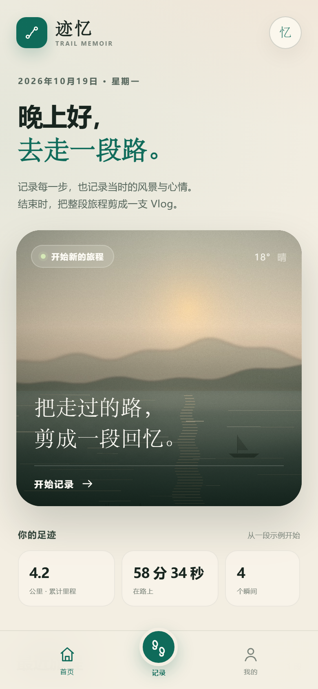
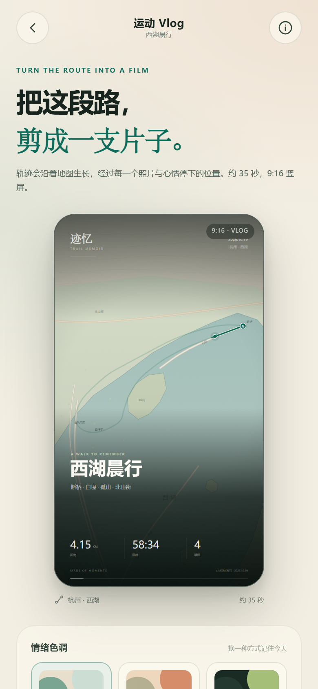
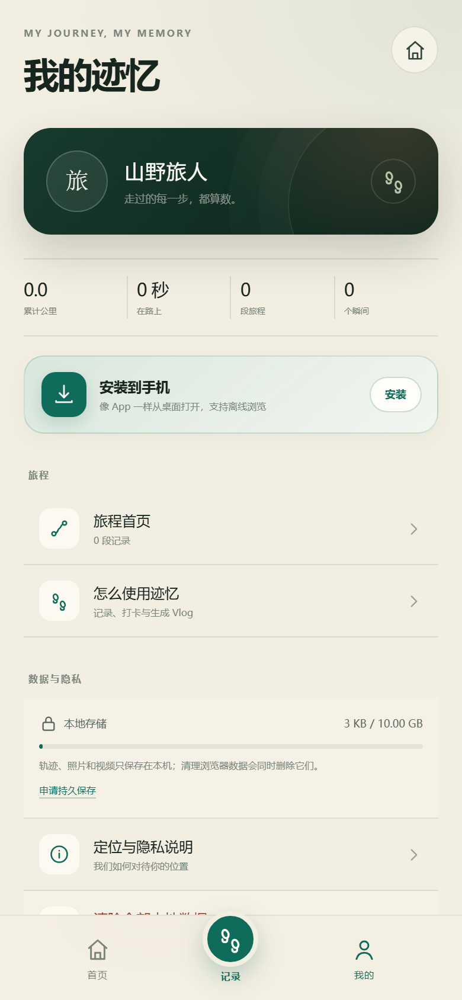
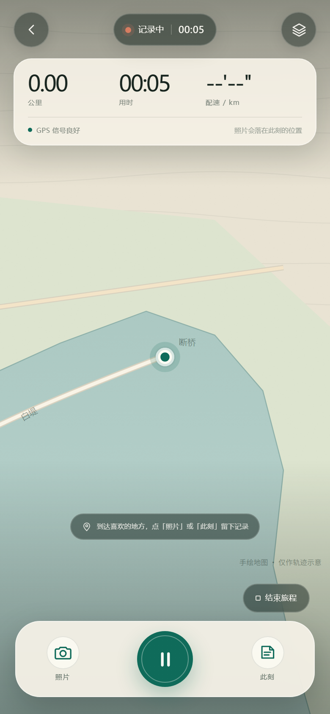
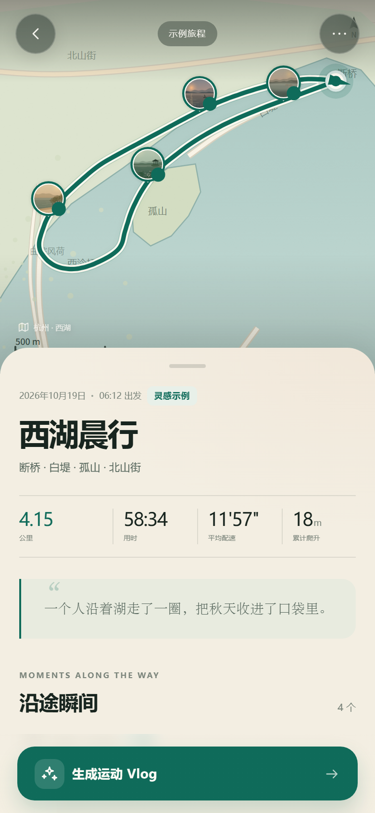
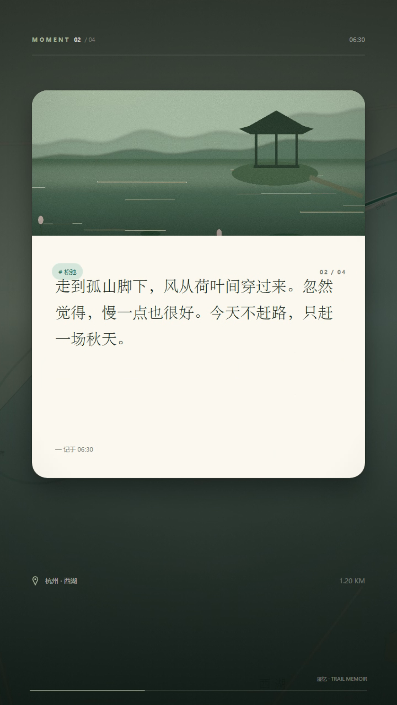

# 迹忆 · Trail Memoir

**把走过的路，剪成一段回忆。**

迹忆是一款手机端运动轨迹记录与运动 Vlog 生成应用。徒步时打开它，轨迹会从地图上慢慢长出来；在喜欢的地方拍一张照片、写几句心情，结束后这些瞬间会按轨迹经过的顺序，自动剪成一支 9:16 竖屏 Vlog。

> 本项目采用 **移动端 Web 小程序（PWA）** 实现：一套代码可以在手机浏览器、微信内置浏览器、添加到主屏幕后运行，也可以部署到任意静态托管。它不是微信原生 `.wxml` 工程；如果必须发布为微信原生小程序，GPS、媒体、Canvas 渲染等核心逻辑可以迁移，但地图与视频编码需要替换为微信 API。




## 1. 已实现的功能

对应最初的三条需求：

| 需求 | 实现 |
| --- | --- |
| 记录运动的地图轨迹 | 使用 `watchPosition` 持续记录 GPS，自动过滤漂移点；地图实时绘制已走路线、起点、当前位置、方向与比例尺。支持手指拖动、缩放、回到当前位置。 |
| 在某个地点拍照/录像，并在 Vlog 到达时展示 | 拍照/选视频时自动绑定当前位置与时间；照片/视频会以圆形照片钉标记在轨迹上。Vlog 时间轴按轨迹进度推进，到达该位置时暂停并展示画面、标题、文字、时间与里程。 |
| 在某个地点输入文字、图片或视频，表达心情/感悟 | 「此刻」编辑器支持 400 字文字、情绪标签，可附加照片或视频。它同样落在当前位置。Vlog 到达时，会以信笺/引文卡片的方式展示。 |

除此之外还有：

- **运动数据**：距离、用时、平均配速、累计爬升；暂停/继续；轨迹点本地草稿恢复。
- **一段完整示例旅程**：内置西湖晨行示例（含 4 个照片/心情瞬间），不需要 GPS、不需要登录，打开即可体验完整 Vlog 导出。
- **三种电影色调**：晨雾、橙光、夜行，可实时切换预览。
- **原创氛围配乐**：浏览器内用 Web Audio 实时合成的轻柔环境音，无版权素材、无需网络。
- **真正的视频文件**：Canvas 逐帧绘制 + MediaRecorder 编码，输出 WebM/MP4（视浏览器支持），并修复 WebM 的时长元数据，进度条可正常拖动。
- **分享与保存**：支持系统分享面板（可分享视频文件到微信/相册），也支持下载到本地。
- **本地优先**：轨迹、照片、视频全部保存在浏览器 IndexedDB，不上传服务器。
- **PWA**：有 manifest、Service Worker 与图标，可以添加到手机主屏幕。

## 2. 快速运行

需要 Node.js 18+（本机已验证 Node 24）。

```bash
cd "D:\AI_APPLY\Intelligent Trajectory"
npm start
```

打开 <http://127.0.0.1:4173>。

也可以直接使用任意静态文件服务器：

```bash
python -m http.server 4173
```

但 **定位 API 要求安全上下文**：`localhost` 或 HTTPS。用手机通过局域网 IP 访问 `http://192.168.x.x:4173` 时，浏览器通常会拒绝定位；正式在手机上使用时，请部署到 HTTPS 站点（Vercel、Netlify、GitHub Pages、Cloudflare Pages 等均可），或使用手机浏览器打开已部署的 HTTPS 地址。

### 手机访问（打不开先看这里）

1. **不要用 `127.0.0.1`**。在手机上，`127.0.0.1` 指的是手机自己，不是电脑。
2. 电脑和手机连接**同一个 Wi-Fi**（手机不要用流量，也不要连访客网络）。
3. 保持电脑上的 `npm start` 窗口运行。
4. 在手机浏览器输入启动日志打印的地址，例如：

   ```text
   http://192.168.31.44:4173
   ```

   IP 会随网络变化；以 `npm start` 最新输出的 `[WLAN]` 地址为准。双击根目录的 `start-mobile.cmd` 也可以启动服务并打开电脑浏览器，新窗口里同样会打印局域网地址。

5. 如果手机仍然超时，通常是 **Windows 防火墙**拦住了入站连接。可先在电脑浏览器打开上述局域网地址确认服务本身正常；然后：
   - 打开「Windows 安全中心 → 防火墙和网络保护 → 允许应用通过防火墙」，找到 `Node.js JavaScript Runtime`，勾选「专用」和「公用」；
   - 或者以管理员身份打开 PowerShell，执行：

   ```powershell
   New-NetFirewallRule -DisplayName "Jiyi Dev 4173" -Direction Inbound -Protocol TCP -LocalPort 4173 -Action Allow -Profile Private,Public
   ```

6. 仍未打开时，检查路由器是否开启了「AP 隔离 / 客户端隔离」；公司、酒店或校园网常会隔离设备。可改用手机热点让电脑连接，或部署到 HTTPS 后再访问。
7. **页面能打开但定位失败**：这是浏览器的安全限制。`http://192.168.x.x` 不是安全上下文，不能调用 GPS。可以先用示例旅程查看界面；真实记录需要 HTTPS。Android 调试时也可以用 USB 执行 `adb reverse tcp:4173 tcp:4173`，然后用手机访问 `http://localhost:4173`（localhost 属于安全上下文）。

### 手机真实定位：用 HTTPS 打开（推荐）

这是解决「找不到位置」最稳妥的方式：

1. 项目根目录已经准备好可直接部署的 [jiyi-static.zip](jiyi-static.zip)（约 2 MB，包含 `index.html`、`js`、`assets`、manifest 和 Service Worker）。
2. 在电脑打开 <https://app.netlify.com/drop>，把 ZIP 拖进去；无需构建命令，Netlify 会返回一个公开的 `https://...netlify.app` 地址。
3. 用手机打开这个 HTTPS 地址，允许「位置 / 精确位置」权限即可真实记录。
4. 也可以把 ZIP 上传到 Vercel、GitHub Pages、Cloudflare Pages 或任意支持静态文件的 HTTPS 服务器。

修改代码后重新打包：

```powershell
Compress-Archive -Path index.html,manifest.webmanifest,sw.js,assets,js -DestinationPath jiyi-static.zip -Force
```

> 用 Netlify Drop 时 ZIP 内必须保留目录结构；直接使用上面生成的 ZIP 即可。部署到 HTTPS 后，定位、拍照、视频导出都不会受到 HTTP 限制。

### 安装成 App（PWA，无需 APK）

部署到 HTTPS 后，在手机浏览器打开：

- **Android Chrome**：右上角菜单 →「安装应用」/「添加到主屏幕」。
- **iPhone Safari**：底部分享 →「添加到主屏幕」。必须用 Safari，微信内置浏览器不行。
- 安装后从桌面图标启动，全屏运行，轨迹与照片仍保存在同一份本地数据里。



这就是最轻量的「安装后就能用」：不需要上架商店，也不需要签名。缺点是依赖浏览器内核，微信内置浏览器仍可能限制视频导出。

### Android 原生壳工程（APK 源码）

项目已经包含一个完整的 Android WebView 壳工程：

- 源码：[android/](android/README.md)
- 可下载构建包：[jiyi-android-build.zip](jiyi-android-build.zip)
- 最低 Android 10（API 29）
- 包名：`com.jiyi.trailmemoir`
- 已集成：本地 HTTPS 安全源、GPS 权限、系统相机/相册、视频保存到 `Movies/迹忆`、系统分享、屏幕常亮、返回键、启动页和图标

构建方式：

1. **Android Studio**：打开 `android` 目录，Sync 后点击 Run，或 Build APK。
2. **命令行**：在 `android` 目录执行 `gradle assembleDebug`，输出 `android/app/build/outputs/apk/debug/app-debug.apk`。
3. **GitHub Actions 云端出包**：仓库已包含 `.github/workflows/android-apk.yml`，推到 GitHub 后运行 `Build Android APK`，下载 Artifacts 中的 debug/release APK 即可，无需本机 Android SDK。

> 当前这台机器没有 JDK / Android SDK，且外网受限，因此源码已完成但没有在本机编译出 APK。使用 Android Studio 或 GitHub Actions 就能生成可安装的 `app-debug.apk`。原生壳的详细说明、签名和已知边界见 [android/README.md](android/README.md)。

### 生成 Android APK（PWABuilder 备选）

如果必须要一个可以发给别人安装的 `.apk`，推荐用 **PWABuilder** 把已经部署好的 HTTPS PWA 包成 Android TWA（Trusted Web Activity）：

1. 先按上一节把应用部署到 HTTPS，例如 `https://your-name.netlify.app`。
2. 打开 <https://www.pwabuilder.com>，输入这个 HTTPS 地址。
3. 选择 **Android**，生成安装包。
4. 下载 `.apk` 可直接在 Android 手机上安装测试；`.aab` 用于 Google Play。请保存好生成的签名密钥，后续更新必须使用同一份密钥。
5. TWA 依赖手机上的 Chrome；如果目标设备没有 Chrome，应改为 Android WebView 原生壳工程。

> 当前这台构建机器没有 JDK / Android SDK，且外网受限，因此无法在这里直接编译 APK。上面的 PWA + PWABuilder 是无需本地 Android 工具链的最短路径。**iPhone 不能安装 APK**，只能通过 Safari 添加到主屏幕，或使用 Apple 开发者账号走 TestFlight / App Store。

### 第一次体验（不需要 GPS）

1. 首页点击 **「西湖晨行」示例旅程**（或直接点击首页的示例卡片）。
2. 查看地图轨迹与 4 个沿途瞬间。
3. 点击底部 **「生成运动 Vlog」**。
4. 选择色调/配乐，点击生成。真实导出约 35 秒（1:1 实时合成），完成后自动弹出视频，可播放、下载或分享。

### 真实记录

1. 首页点 **「开始记录」**，允许定位。
2. 到达喜欢的地方：
   - **照片**：拍摄照片，或从相册选择照片/视频；可写一句说明。
   - **此刻**：写文字、选心情，也可以附一张照片/短视频。
3. 结束后点 **「结束旅程」**，命名并保存。
4. 在旅程详情页点 **「生成运动 Vlog」**。

## 3. 更多截图

| 记录中 | 旅程详情 |
| --- | --- |
|  |  |

Vlog 中的「文字心情」瞬间：



## 4. Vlog 是怎么生成的

1. **时间轴**：`js/timeline.js` 根据路线距离比例，为每个瞬间计算它在轨迹上的进度。时间轴包含片头、路线行进、瞬间停留、片尾四类阶段。
2. **绘制**：`js/vlog.js` 使用 720×1280 Canvas 逐帧绘制地图、已走路线、当前位置、经过时出现的照片/文字卡片、片头片尾与进度条。
3. **视频编码**：`MediaRecorder` 捕获 `canvas.captureStream(30)`，视频码率约 6 Mbps；如果开启配乐，会把 Web Audio 的 `MediaStreamDestination` 混入音轨。
4. **时长修复**：Chrome 录制的 WebM 默认没有 Duration 元数据，导致播放器显示无限时长、不能拖动。`js/webm.js` 在 Info 段中插入 Duration，视频即可正常显示 34.9 秒并支持 seek。
5. **保存**：视频 Blob 存入 IndexedDB；旅程页下次打开仍能看到最近一次导出的 Vlog。

生成是 **实时** 的：成片约 35 秒，生成过程也需要约 35 秒。请保持页面在前台。

## 5. 目录结构

```text
.
├─ index.html                 应用入口
├─ server.mjs                 零依赖静态服务器
├─ manifest.webmanifest       PWA manifest
├─ sw.js                      Service Worker
├─ assets/
│  ├─ css/app.css             设计系统、首页、通用组件
│  ├─ css/pages.css           记录/旅程/导出/我的
│  ├─ demo/                   程序化生成的示例风景图（离线可用）
│  └─ icons/                  PWA 图标
├─ js/
│  ├─ app.js                  极简 hash 路由
│  ├─ geo.js                  Haversine、路线插值、统计、格式化
│  ├─ timeline.js             Vlog 时间轴
│  ├─ map.js                  手绘地图 + 可选在线底图、轨迹与照片钉
│  ├─ vlog.js                 Canvas 分镜绘制、MediaRecorder 导出
│  ├─ audio.js                生成式环境配乐
│  ├─ webm.js                 WebM Duration 修复
│  ├─ recorder.js             GPS 轨迹记录器与草稿
│  ├─ db.js                   IndexedDB（trips/media/exports/settings）
│  ├─ media.js                图片压缩、视频封面、媒体 URL
│  ├─ demo.js                 西湖示例数据
│  ├─ themes.js               三种 Vlog 色板
│  ├─ icons.js / ui.js        图标、Toast、Sheet、确认弹窗
│  └─ pages/                  首页 / 记录 / 旅程 / 导出 / 我的
├─ tests/                     Node 单元测试 + 浏览器测试辅助页
├─ tools/                     示例图生成、CDP 截图与端到端测试脚本
└─ docs/screenshots/          最终界面截图
```

## 6. 数据与隐私

- 没有后端，没有账号，没有埋点。
- 轨迹、文字、照片、视频存在浏览器的 IndexedDB；草稿存在 `localStorage`。
- 「我的 → 数据与隐私」可以查看存储占用、申请持久保存、清除全部数据。
- 在线标准地图会向 CARTO / OpenStreetMap 请求瓦片（仅瓦片，不包含轨迹数据）；无网络时自动回退为手绘示意图。
- 清理浏览器站点数据、卸载浏览器、换设备都会导致数据丢失；重要旅程请先导出视频。

## 7. 浏览器支持

| 浏览器 | 记录 | 照片/视频 | Vlog 导出 |
| --- | --- | --- | --- |
| Android Chrome / Edge | ✅ | ✅ | ✅ WebM |
| 桌面 Chrome / Edge | ✅ | ✅ | ✅ WebM |
| iOS Safari 17+ | ✅ | ✅ | 取决于系统版本；优先尝试 MP4，可能不支持 Canvas 录制 |
| 微信内置浏览器 | 视版本 | 视版本 | 可能不支持 MediaRecorder，建议「在浏览器打开」 |

如果导出按钮提示不支持，请用系统 Chrome / Edge 打开同一个 HTTPS 地址。定位必须使用 HTTPS 或 localhost；微信内置浏览器对 `capture` 与视频编码的支持差异较大。

## 8. 测试

```bash
npm test
```

当前覆盖：

- 球面距离、累计距离、按比例插值、路线切片；
- 统计（距离/用时/配速/爬升）；
- 示例路线与时间轴阶段连续性；
- 无瞬间旅程仍可生成时间轴。

浏览器端还提供：

- `tests/preview.html`：在 390×844 iframe 中预览任意页面；
- `tools/cdp-shot.mjs`：通过 Chrome DevTools Protocol 模拟手机视口截图；
- `tools/record-flow.mjs`：注入模拟 GPS，完整跑通「记录 → 拍照 → 写心情 → 保存」；
- `tools/vlog-frames.mjs`：真实导出 Vlog 并抽取关键帧，验证时长与可 seek；
- `tests/webm-test.html`：单独验证 WebM 时长修复。

> 这些浏览器测试脚本依赖本机 Chrome，仅用于开发验收；应用本身不依赖它们。

## 9. 当前边界与下一步

- **地图是双模式**：默认尝试在线 CARTO/OSM 标准地图，失败时回退手绘示意；示例数据的手绘背景只对西湖区域做了地理近似，其他城市会显示地形示意图。若要在生产环境做全国地图，建议接入高德/腾讯地图 JS SDK（需要 key 与合规配置）。
- **没有逆地理编码**：地点名称目前显示「杭州 · 西湖」或「我的旅程」，可接高德/腾讯逆地理 API。
- **视频是实时合成**：35 秒成片需要 35 秒生成；未来可改为 WebCodecs 离线逐帧编码，速度会快很多。
- **没有云同步**：当前是刻意的本地优先设计。
- **未做赛道/跑步专业指标**：目前以徒步为主，已预留 `activity` 字段。
- **微信原生小程序移植**：如果目标是发布微信小程序，需要替换 GIS、相机、媒体存储和视频编码 API；本项目的 UI/数据模型/时间轴/Vlog 分镜可以复用。

## 10. 示例素材说明

`assets/demo/` 中的四张风景图与首页大图由 `tools/generate_demo_assets.py` 使用 Pillow 程序化生成，不依赖外部图片、无第三方版权。它们是插画式素材，用于离线演示；用户拍摄的照片与视频不会被上传或替换。

## 11. 推送到 GitHub 并用云端生成 APK

本目录已经初始化为 `main` 分支的 Git 仓库，并且完成了一次本地提交。接下来只需要在 GitHub 创建一个**空仓库**并关联远程地址。

### 1. 在 GitHub 创建空仓库

1. 打开 <https://github.com/new>。
2. Repository name 填 `jiyi-trail-memoir`（可自定义）。
3. 选择 Public 或 Private。
4. **不要**勾选 “Add a README file”“Add .gitignore”“Choose a license”。
5. 点击 **Create repository**。

### 2. 关联并推送

在项目目录打开 PowerShell：

```powershell
cd "D:\AI_APPLY\Intelligent Trajectory"
git remote add origin https://github.com/<你的用户名>/<仓库名>.git
git branch -M main
git push -u origin main
```

把 `<你的用户名>` 和 `<仓库名>` 换成实际值。第一次推送会弹出 GitHub 登录窗口（Git Credential Manager），登录并授权即可。

如果提示 `remote origin already exists`：

```powershell
git remote set-url origin https://github.com/<你的用户名>/<仓库名>.git
git push -u origin main
```

如果误建了带 README 的非空仓库，先执行：

```powershell
git pull --rebase origin main
git push -u origin main
```

### 3. 生成 APK

1. 打开 GitHub 仓库的 **Actions** 标签。
2. 左侧选择 **Build Android APK**。
3. 点击 **Run workflow → Run workflow**。
4. 等待 3–8 分钟。
5. 进入该次运行，在页面底部 **Artifacts** 下载 `jiyi-android-apks`。
6. 解压后安装 `app-release.apk`（或 `app-debug.apk`）到 Android 手机。

如果看不到 Actions 或工作流，检查仓库根目录是否存在：

```text
.github/workflows/android-apk.yml
```

通过 GitHub 网页拖拽上传时，隐藏的 `.github` 目录有时会被忽略；推荐用 Git 命令，或 GitHub Desktop。

### 不想用命令行：GitHub Desktop

1. 安装 [GitHub Desktop](https://desktop.github.com/) 并登录。
2. **File → Add local repository**，选择 `D:\AI_APPLY\Intelligent Trajectory`。
3. 点击 **Publish repository**。
4. 勾选/取消 “Keep this code private” 后发布。
5. 后续修改点击 **Push origin** 即可，然后在 GitHub Actions 中出包。

### 认证提示

GitHub 不再接受账号密码推送。推荐使用 Git Credential Manager 弹出的浏览器登录；如果使用 Personal Access Token，至少需要：

- `repo`：读写仓库
- `workflow`：推送 `.github/workflows` 下的工作流文件

### 推送前检查

```powershell
git status
git log --oneline -1
```

当前本地提交应包含 Web 应用、`android/` 壳工程、`.github` 工作流、图标与构建脚本。浏览器缓存目录、`android/app/build`、`node_modules` 已通过 `.gitignore` 排除。

---

迹忆 · 慢一点，才看得见风景。
